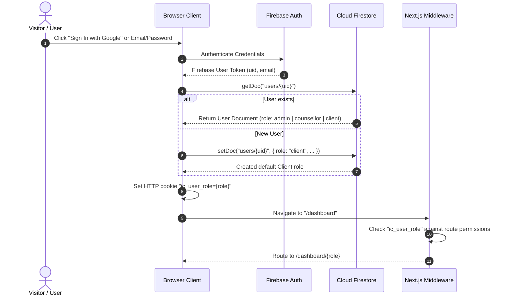

# 🏛️ System Architecture — Inspiria Careers

This document maps out the system architecture, routing, component hierarchy, data lifecycle, and authentication flow.

---

## 1. Routes & Pages Map

| Route | Access | Purpose | Key Data Sources |
| :--- | :--- | :--- | :--- |
| `/` | Public | Home page with Hero, credentials, services preview, reviews, and announcement banner | `siteContent/settings`, `services`, `reviews` |
| `/about` | Public | Counsellor profile, verified qualifications, bio, and ethics commitment | `siteContent/settings` (`profile`) |
| `/services` | Public | Full listing of career guidance and counselling offerings | `siteContent/settings` (`services`) |
| `/gallery` | Public | Photos and video recordings of workshops, sessions, and seminars | `siteContent/settings` (`gallery`) |
| `/posts` | Public | Guidance blog list with category filter and search | `posts` (`published == true`) |
| `/posts/[slug]` | Public | Full blog article view with dynamic SEO metadata and OpenGraph tags | `posts` doc by `slug` |
| `/reviews` | Public | Testimonials and feedback from verified students/clients | `reviews` (`approved == true`) |
| `/book` | Public / Client | Interactive appointment scheduler with dynamic service selection and slot lock | `appointments`, `siteContent/settings` |
| `/contact` | Public | Office address, phone, WhatsApp direct chat, and message inbox form | `siteContent/settings`, `messages` |
| `/privacy` | Public | Privacy policy, ethics code, and student data protection agreement | `siteContent/settings` |
| `/login` | Public | Google One-Click & Email/Password sign-in with role redirect | Firebase Auth, `users/{uid}` |
| `/signup` | Public | Client registration with automatic role assignment (`client`) | Firebase Auth, `users/{uid}` |
| `/forgot-password` | Public | Secure password reset email trigger | Firebase Auth |
| `/dashboard` | Protected | Smart dispatcher routing user to `/dashboard/{role}` | `AuthContext` |
| `/dashboard/admin` | Admin Only | User management, role elevation, theme presets, master settings | `users`, `siteContent/settings` |
| `/dashboard/counsellor`| Counsellor / Admin | Profile editor, services, gallery, posts editor, appointment manager, messaging, feedback, subscribers | `siteContent/settings`, `posts`, `appointments`, `threads`, `sessionFeedback`, `subscribers` |
| `/dashboard/client` | Client / All | Scheduled appointments, private notes/documents, feedback submission, secure messaging, reminder preferences | `appointments`, `clientNotes`, `clientDocuments`, `reviews`, `threads`, `reminderPreferences` |
| `/api/newsletter/subscribe` | Public (POST) | Double opt-in newsletter registration | `subscribers` |
| `/api/newsletter/confirm` | Public (GET) | Cryptographic confirmation token verification | `subscribers` |
| `/api/newsletter/unsubscribe` | Public (GET) | One-click instant unsubscription link handler | `subscribers` |

---

## 2. Authentication & Authorization Flow



---

## 3. Data Flow Architecture

### Site Content Lifecycle
1. **Initial Paint**: `SiteContext` reads cached data from `localStorage` (`ic_site_v2`) for instant paint with zero layout shift.
2. **Firestore Sync**: A background query fetches `siteContent/settings` from Cloud Firestore.
3. **Theme Application**: Custom CSS variables (`--brand-primary`, `--brand-secondary`, `--font`) are immediately injected onto `:root`.
4. **Cross-Tab Synchronization**: Updates made in the Counsellor or Admin dashboard trigger `StorageEvent` listeners, syncing open tabs in real-time.

### Appointments Flow
1. Visitor or Client selects an available date, time slot, and session mode (`Online` or `In-Person`) on `/book`.
2. Form checks existing bookings to prevent double-booking.
3. Record is created in `appointments` collection with status `"pending"`.
4. Counsellor views request on `/dashboard/counsellor` and changes status to `"confirmed"`, `"completed"`, or `"cancelled"`.
5. Client monitors live status in their personal dashboard (`/dashboard/client`).

---

## 4. Component Hierarchy

```text
RootLayout (src/app/layout.tsx)
 ├── AuthProvider (src/contexts/AuthContext.tsx)
 │    └── SiteProvider (src/contexts/SiteContext.tsx)
 │         ├── Navbar (src/components/Navbar.tsx)
 │         │    ├── Brand Logo & Dynamic Title
 │         │    ├── Bilingual Switcher (EN / HI)
 │         │    └── Role-Aware Dashboard Link
 │         ├── Page Content (Children)
 │         └── Footer (src/components/Footer.tsx)
 │              ├── Emergency Helpline Notice
 │              ├── Dynamic Social Links
 │              └── Privacy & Legal Disclaimers
```
