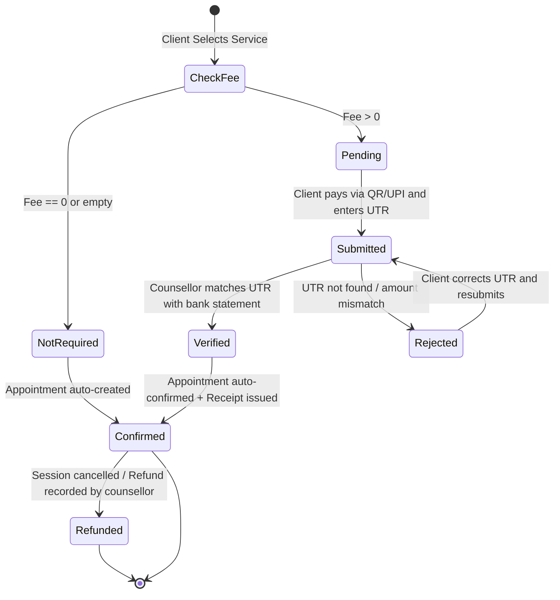

# 💳 Manual QR & UPI Payment System Architecture

> **Version:** 4.0.0 (Production)  
> **Approach:** Direct UPI / QR Code (Zero Third-Party Gateway SDKs, Zero Commission)  
> **Security:** Backend-enforced Firestore Rules + Anti-Fraud UTR Index + Dual-Layer Verification

---

## 1. Overview & Architectural Philosophy

The **Inspiria Careers** payment system provides a direct, transparent, and fee-free transaction pipeline between clients and the counsellor:

1. **Zero Gateway Costs & Vendor Lock-in:** No Razorpay, Stripe, or Cashfree SDKs. 100% of the consultation fee goes directly into the counsellor's official bank account without gateway commissions (typically 2-3% + GST) or multi-day payout delays.
2. **Accessible Everywhere in India:** Powered by standard UPI (Unified Payments Interface), supporting Google Pay, PhonePe, Paytm, BHIM, and bank mobile applications.
3. **Dual-Layer Verification:** Clients submit payment details along with the official 12-digit UPI Transaction Reference (UTR) number. Appointments remain unconfirmed until the counsellor manually validates the UTR against their real bank or UPI application statement.
4. **Computer-Generated Digital Receipts:** Upon verification, the system automatically issues a standardized, printable digital receipt (`REC-YYYYMMDD-XXXX`) complete with full service details, branding, transaction reference, and legal disclaimers.

---

## 2. Payment Lifecycle & State Machine

### State Definitions

| State | Who Triggers | Description |
|---|---|---|
| `not_required` | System | Service is free or complimentary. Appointment is created directly without payment. |
| `pending` | System | Appointment booked. Awaiting client to scan QR, pay via UPI, and submit UTR. |
| `submitted` | Client | Client has transferred the fee and submitted the 12-digit UTR number and optional screenshot. |
| `verified` | Counsellor / Admin | Counsellor verified the credit in bank statement. Auto-confirms appointment and generates receipt. |
| `rejected` | Counsellor / Admin | UTR was invalid or unconfirmed in bank. Client can view counsellor's reason and resubmit. |
| `refunded` | Counsellor / Admin | Fee was refunded to the client. Session is marked cancelled. |

---

## 3. Fraud Prevention & Security Protections

### A. Strict Database Security Rules (`firestore.rules`)
- **Prohibited Client Self-Verification:** Clients are strictly blocked from writing `paymentStatus: "verified"` or `paymentStatus: "refunded"`. Any unauthorized attempt is rejected at the Firestore database layer.
- **Controlled State Transitions:** Clients can only transition from `pending` or `rejected` to `submitted`. Once verified, client writes to that appointment document are locked.
- **Immuntable Verification Metadata:** Only users with `counsellor` or `admin` roles can set `verifiedAt`, `verifiedBy`, and `receiptNumber`.

### B. Unique UTR Anti-Fraud Index (`trNumbers/{utr}`)
- To stop malicious clients from reusing the same transaction reference number across multiple appointments, each submitted UTR is indexed in a dedicated `trNumbers` collection.
- If a client attempts to submit an already-indexed UTR, the system flags the appointment with an `isDuplicateUtr: true` indicator and warns the counsellor with a prominent red alert banner.

### C. Private Payment Screenshot Storage (`storage.rules`)
- Payment screenshots are uploaded to a secured bucket path: `/payments/{userId}/{fileName}`.
- Read access is restricted strictly to the client owner, verified counsellors, and administrators. Public unauthorized access is blocked.

### D. UTR Formatting & Sanitization (`validateUtr`)
- Strips whitespace and special characters.
- Validates standard alphanumeric format (8 to 25 characters, standard Indian banking length is 12 digits).
- Converts all characters to uppercase.

---

## 4. Roles & Permissions Matrix

| Capability | Client | Counsellor | Administrator |
|---|:---:|:---:|:---:|
| Upload / Change Payment QR Code | ❌ | ✅ | ✅ |
| Configure UPI ID & Payee Name | ❌ | ✅ | ✅ |
| Set Service Fees (INR) | ❌ | ✅ | ✅ |
| Scan QR & Submit UTR Reference | ✅ (own) | ❌ | ❌ |
| Upload Payment Screenshot | ✅ (own) | ❌ | ❌ |
| Verify Payment & Issue Receipt | ❌ | ✅ | ✅ |
| Reject Payment with Reason | ❌ | ✅ | ✅ |
| Record Client Refund | ❌ | ✅ | ✅ |
| View / Print Official Receipt | ✅ (own) | ✅ (all) | ✅ (all) |
| Export Financial Report (CSV) | ❌ | ✅ | ✅ |

---

## 5. Official Receipt Specification

When a payment is marked as `verified`, a computer-generated receipt is minted with:
- **Receipt Number:** `REC-YYYYMMDD-XXXX` (where `XXXX` is the unique appointment suffix).
- **Branding:** Site Name, Logo, Counsellor Name, Official Email, and Phone dynamically loaded from `siteContent/settings`.
- **Client Details:** Client Name, Phone, and Email.
- **Transaction Info:** Service Title, Session Slot, Fee Amount (₹), Payment Date, and UTR Reference.
- **Compliance Disclaimer:** *"This is a computer-generated digital receipt issued by Inspiria Careers. Valid without physical signature."*
- **Refund Policy Note:** Dynamically included from the counsellor's configured refund policy.

---

## 6. Counsellor Verification Guide (काउंसलर के लिए गाइड)

### 📌 पेमेंट कैसे वेरीफाई करें (Step-by-Step):

1. **Dashboard खोलें:** Counsellor Dashboard में बाईं तरफ **"💳 Payments to Verify"** टैब पर क्लिक करें।
2. **सबमिट किए गए पेमेंट्स देखें:** जिस भी क्लाइंट का स्टेटस **"⏳ Verification Pending"** दिख रहा हो, उसका UTR नंबर और फीस देखें।
3. **अपनी Bank या UPI App खोलें:**
   - अपने फोन पर Google Pay, PhonePe, Paytm, या BHIM App खोलें।
   - **Transaction History / Passbook** में जाएं।
   - क्लाइंट का दिया गया **12-digit UTR / UPI Ref No.** सर्च या मैच करें।
   - जांचें कि क्या ठीक वही राशि (Amount) आपके बैंक खाते में क्रेडिट हुई है।
4. **Duplicate Warning पर ध्यान दें:**
   - यदि लाल रंग का बैज **"⚠️ DUPLICATE UTR DETECTED"** दिखे, तो इसका अर्थ है कि यह UTR पहले किसी अन्य बुकिंग में इस्तेमाल हो चुका है। ऐसे पेमेंट को बैंक में दोबारा चेक किए बिना वेरीफाई न करें।
5. **Verify बटन दबाएं:**
   - बैंक में क्रेडिट की पुष्टि होने के बाद ही **"✓ Verify & Confirm"** पर क्लिक करें।
   - सिस्टम अपने आप अपॉइंटमेंट को कंफर्म कर देगा और क्लाइंट के लिए डिजिटल रसीद जारी कर देगा।

---

### ❌ पेमेंट कब रिजेक्ट (Reject) करें:

निम्न परिस्थितियों में **"✕ Reject"** बटन दबाएं और स्पष्ट कारण लिखें:
1. UTR नंबर आपकी बैंक पासबुक या स्टेटमेंट में नहीं मिल रहा है।
2. क्लाइंट ने पूरी फीस के बजाय कम राशि भेजी है।
3. क्लाइंट ने फर्जी या एडिट किया हुआ स्क्रीनशॉट अपलोड किया है।
4. ट्रांजैक्शन आपके खाते में फेल या रिवर्स हो चुका है।

> **नोट:** रिजेक्ट करने पर क्लाइंट को तुरंत कारण दिखेगा और वह अपने डैशबोर्ड से सही UTR दोबारा सबमिट कर सकेगा।

---

### ↩ रिफंड (Refund) कैसे रिकॉर्ड करें:

1. यदि क्लाइंट ने पॉलिसी के अनुसार समय से पहले सेशन रद्द कराया है:
2. अपने बैंक/UPI ऐप से क्लाइंट के UPI खाते में पैसे वापस ट्रांसफर करें।
3. Counsellor Dashboard में उस वेरीफाइड पेमेंट के आगे **"↩ Record Refund"** पर क्लिक करें।
4. रिफंड की गई राशि और विवरण (जैसे *"GPay द्वारा 17-Oct को रिफंड किया गया"*) दर्ज करें।
5. अपॉइंटमेंट अपने आप **Cancelled** और पेमेंट **Refunded** के रूप में सुरक्षित रिकॉर्ड में दर्ज हो जाएगी।
